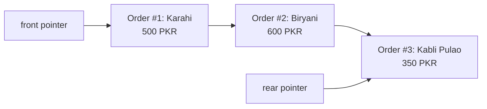

# ☕ High-Efficiency Cafe Order Management System

[](#)
[](#)
[%20Enqueue%2FDequeue-brightgreen.svg)](#)
[](#)
[](LICENSE)

> A console-based Cafe POS & kitchen ticketing workflow implemented in C++, coupling a dynamic **Singly Linked List** with a **FIFO Queue** to manage real-time order processing, dynamic customer dispatching, and automated billing.

---

## 🏗️ Architectural Design: Linked Queue

The system models a high-throughput cafe counter using a composite **Linked List Queue**:
- **Dynamic Node Allocation:** Each food order (`Node`) encapsulates customer identification, unique sequential order IDs, item names, pricing, and pointer link to the next order.
- **Constant Time Enqueue ($\mathcal{O}(1)$):** New tickets are appended to `rear->next` instantly without array re-allocation overhead.
- **Constant Time Dequeue ($\mathcal{O}(1)$):** Prepared meals are dispatched by advancing `front = front->next`, ensuring strict First-In, First-Out (FIFO) kitchen discipline.
- **Bill Calculation ($\mathcal{O}(N)$):** Traverses pending customer tickets for receipt generation.



---

## ⚡ Algorithmic Complexity

| Operation | Implementation | Time Complexity | Auxiliary Space |
| :--- | :--- | :---: | :---: |
| **Enqueue Order** | `Additems(int item_id, string name)` | $\mathcal{O}(1)$ | $\mathcal{O}(1)$ per item |
| **Process / Dispatch Next** | `processed()` | $\mathcal{O}(1)$ | $\mathcal{O}(1)$ |
| **Audit Active Queue** | `Orders()` | $\mathcal{O}(N)$ | $\mathcal{O}(1)$ |

---

## 🍽️ Sample Menu & Console Walkthrough

```text
..Available Food Items..
1. Karahi       - 500 PKR
2. Biryani      - 600 PKR
3. Kabli Pulao  - 350 PKR
4. Coca Cola    -  90 PKR
5. Pepsi        - 110 PKR

Enter your Item for order: 2
Enter your name: Arslan
Order Placed Successfully! (Order ID: 1)
```

---

## 🛠️ Build & Execution

```bash
# Clone the repository
git clone https://github.com/arslantariq364/Cafe-Management-System-.git
cd Cafe-Management-System-

# Compile with GCC
g++ -std=c++17 -Wall -Wextra -O2 "Cafe Management System.cpp" -o cafe_system

# Execute
./cafe_system
```

---

## 👨‍💻 Author

**Arslan Tariq**  
*Computer Science Undergraduate @ FAST NUCES*  
*Applied Physics Teaching Assistant*  
[GitHub Profile](https://github.com/arslantariq364)

---

## 📜 License

Distributed under the MIT License. See [LICENSE](LICENSE) for details.
